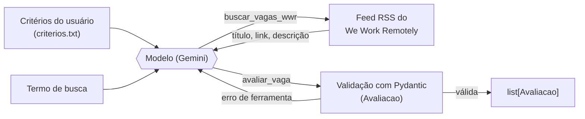

# Agente de Triagem de Vagas Remotas

Agente em Python que lê o feed de programação do We Work Remotely e usa o Gemini, com function calling, para decidir quais vagas valem a candidatura.

[](https://github.com/Acciolyy/agente-triagem-vagas/actions/workflows/ci.yml)

## Por que fiz

Triar vagas remotas na mão toma tempo: abrir cada anúncio só para descobrir que pede outro nível, outra stack ou residência nos EUA. Quis automatizar essa triagem, mas o objetivo maior era praticar a engenharia que fica em volta de um LLM: ferramentas, validação, testes e, principalmente, avaliação.

## Resultado

Medi o agente com vagas rotuladas por mim, a partir do mesmo texto que ele recebe:

- **Nas 80 vagas reais** (59 do We Work Remotely e 21 do backend-br/vagas): 92,4% de descarte correto (73 de 79), com 6 falsos positivos.
- **No controle sintético** (16 vagas em 8 pares de contraste): recall de 100% e precisão de 80%.
- **Principal erro:** o agente não exige Python em vagas de IA/ML e dados. É o que aparece nos 6 falsos positivos reais e nos 2 do controle sintético.

O relatório completo, com a metodologia e as limitações, está em [docs/EVAL.md](docs/EVAL.md).

## Como funciona



Módulos de `src/triagem/`:

- `config.py`: variáveis de ambiente e constantes.
- `feed.py`: busca e parsing do feed RSS, com filtro por termo.
- `criterios.py`: perguntas, formatação dos critérios pelo Gemini e leitura/escrita de `criterios.txt`.
- `modelos.py`: modelos Pydantic `Vaga` e `Avaliacao`.
- `agente.py`: system prompt, declaração das ferramentas e o loop de function calling.

## Decisões técnicas

- **Function calling.** A alternativa seria pedir JSON no prompt e interpretar o texto da resposta; usei function calling porque o schema das ferramentas e o enum do veredito ficam declarados, e a resposta do modelo chega como uma chamada estruturada.
- **A ferramenta só registra e valida; quem decide é o modelo.** A alternativa seria filtrar as vagas por palavras-chave no código; usei o modelo como decisor porque ler a vaga contra os critérios é justamente o que quero que ele faça, e porque assim a avaliação mede o julgamento do modelo, não regras que eu escrevi. `avaliar_vaga` não tem lógica de decisão.
- **Pydantic na ferramenta.** A alternativa seria confiar só no enum do schema da ferramenta, que não cobre, por exemplo, um motivo vazio; usei `Avaliacao` (veredito restrito a "aplicar" ou "não aplicar", motivo não vazio) para validar os argumentos. Argumento inválido volta ao modelo como erro de ferramenta, e o programa não cai.
- **Feed RSS do We Work Remotely.** A alternativa seria a API do Remote OK; usei o feed RSS porque a API passou a servir um conjunto genérico e limitado de vagas, que rendia pouquíssimos resultados para termos como "python".
- **Avaliação com rótulo humano e controle sintético em pares de contraste.** A alternativa seria usar outro LLM como juiz; usei rótulos feitos por mim, a partir do mesmo texto que o agente recebe, porque dão um gabarito independente do tipo de modelo que estou avaliando. Como sobrou um único positivo, criei os pares de vagas iguais exceto por um fator (nível, Python, local, stack, modelo de trabalho).
- **Testes com LLM falso.** A alternativa seria testar contra a API real; usei um cliente falso que devolve chamadas de função pré-definidas (inclusive com argumentos inválidos e timeout) porque o CI fica rápido e determinístico, e porque durante o projeto a API devolveu 503 e 429 várias vezes.

## Desafios e o que aprendi

- **As vagas reais quase não têm positivos.** Das 80 vagas, só uma ficou como "aplicar". Reforcei a seleção com termos do tema e ainda assim nenhuma das 19 vagas extras entrou. Com um positivo, precisão e recall de "aplicar" não dizem nada. Isso me levou ao conjunto sintético, que tem 8 positivos e 8 negativos por construção e mostra a reação do agente a cada fator isolado.
- **O controle sintético apontou a causa dos erros.** Os falsos positivos reais eram todos de IA/ML, e eu desconfiava do nível; o sintético mostrou que o agente respeita o nível quando ele é explícito e erra quando só a menção a Python muda (0 de 2 pares).
- **Avaliar um LLM exige tolerar a API.** Cotas (429) e indisponibilidade (503) me levaram a fazer o `avaliar.py` retomável (`--retomar`), reaproveitando as decisões já gravadas.
- **Uma requisição sem resposta.** A avaliação travou numa chamada ao Gemini que ficou mais de 10 minutos sem resposta e sem erro. Isso me levou a configurar um timeout de 60 s nas chamadas e a tratar o estouro como erro recuperável, no mesmo caminho do 429 e do 503: nova tentativa com espera crescente e, esgotadas as tentativas, uma mensagem clara na interface e no terminal e, na avaliação, a vaga marcada como "sem decisão". Cobri o comportamento com testes que simulam o timeout no cliente falso.

## Limitações e próximos passos

- Poucos positivos reais, um único rotulador, uma execução por conjunto e decisão com apenas 300 caracteres de cada vaga (detalhes no [EVAL.md](docs/EVAL.md)).
- O feed do We Work Remotely traz só cerca de 25 vagas por categoria.
- **Próximo passo:** fazer o agente checar o nível e o Python de forma explícita antes de decidir (extrair os dois da vaga, com a evidência, e tratar "não informado" como incerto) e rodar de novo os mesmos três conjuntos para comparar.

## Stack

Python 3.11, Gemini (SDK `google-genai`), Pydantic, feedparser, requests, Streamlit, pytest, ruff, GitHub Actions e Docker.

## Rodar localmente

```bash
cp .env.example .env   # preencha GEMINI_API_KEY
docker build -t agente-triagem-vagas .
docker run --env-file .env -p 8501:8501 agente-triagem-vagas
```

Abra http://localhost:8501. Para rodar sem Docker, pelo terminal e para os testes, veja [docs/SETUP.md](docs/SETUP.md).
